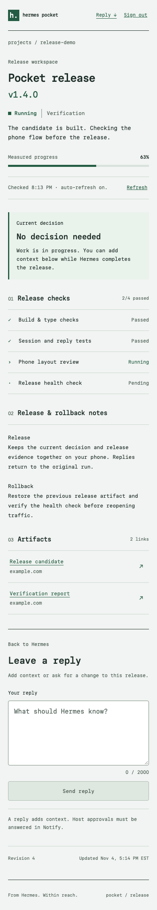
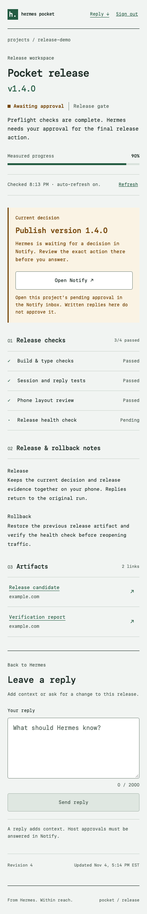
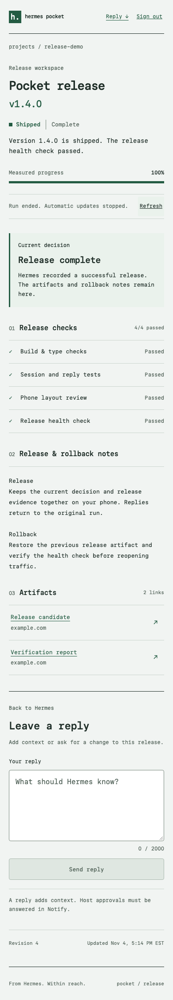

# Catalog PRs

- 0.2.0: [NousResearch/hermes-agent#149220](https://github.com/NousResearch/hermes-agent/pull/149220), merged, pinned to `698b66b`, macOS only.
- 0.2.1: SHA-bump PR pinned to `15651c9220ccf780f988b57f5ab1d249a9cbf654`: Linux and Windows support, standalone `notify_send`/`notify_ask`, `hermes notify setup` onboarding, no install-time dependency consent. CI passes on ubuntu, macOS and Windows.

The 0.2.0 PR description follows.

# Catalog PR: add Hermes Pocket to the plugin catalog

The catalog PR is open: [NousResearch/hermes-agent#149220](https://github.com/NousResearch/hermes-agent/pull/149220). This is its description text. The repository is public at https://github.com/Belweave/hermes-notify. [The entry](../plugin-catalog/hermes-notify.yaml) is pinned to `698b66b6d64a87d317ba97938f37f9ed75f04cd6`, which is on public `main`. It adds the explicit `hermes-notify/0.2.0` User-Agent fix (workers.dev answers Python's default agent with 403) on top of the Paper design pass and the regression tests from `6dfd871`. Its screenshot URLs use the same commit. The quoted version is `"0.2.0"`; the SHA is the install pin. The upstream PR adds only `plugin-catalog/hermes-notify.yaml`, not the standalone implementation. Subsequent updates need a new catalog PR, a version label matching the new pin, and screenshot URLs updated to that pin.

## What does this PR do?

Hermes Pocket keeps a release task available on a phone through Notify by belweave. Hermes publishes a full release workspace to a configured Cloudflare Worker, sends its Notify App link, reports measured progress, asks for an exact native approval, and publishes the result after the release action finishes. Written replies return to their original run and session. The optional Desktop/Webapp pane shows Apps, runs, pending decisions and delivery health.

The first publisher updates the supplied release template and can register existing HTTPS Apps. Worker infrastructure is provisioned separately. The Notify CLI is optional. The Python runtime has no third-party dependencies or LLM calls.

## Related Issue

No related issue is claimed or automatically closed. Read-only GitHub searches on November 4, 2026 covered open and closed PRs/issues for `Belweave` and the Hermes Notify topic, plus the current catalog/source. No matching Belweave submission was returned. The broad hyphenated-name search returned unrelated Notify/kanban work and is not evidence of an exhaustive uniqueness search. The focused search was repeated before the PR was opened.

## Type of Change

- [x] New feature: a community catalog entry for a standalone plugin.

## Changes Made

- Add `plugin-catalog/hermes-notify.yaml` in the upstream catalog with an exact commit, truthful platform metadata, screenshots and matching capabilities.
- Keep the Python runtime, Worker, App, optional Desktop surface, bundled skill, tests and documentation in the standalone repository.

## How to Test

1. In a clean checkout of the submitted plugin commit, run `hermes plugins validate . --install-deps` and inspect every warning. Run `hermes plugins doctor . --ci` for actual discovery and registration.
2. Follow the README development setup, then run `.venv/bin/python -m pytest`, `node worker/scripts/isolated.mjs test`, and the App/Desktop/backend commands in `docs/VERIFICATION.md`.
3. Build the Worker and run `.venv/bin/python scripts/release_demo.py --answer approve`, then the `deny` and `timeout` variants. Check the action receipt exists only for approval and each result belongs to the original task.
4. In the future `hermes-agent` catalog PR checkout, run its entry-schema validator and prescribed CI checks. Those upstream-PR checks are not claimed by the standalone test results.

Tested platform: macOS on arm64. Linux and Windows are not claimed by this entry. No Apple-platform build is needed.

## Public extension surfaces and declarations

| Surface | Registration or use |
| --- | --- |
| Native entrypoint | `plugin.yaml` and `__init__.py:register(ctx)`, manifest v2, standalone, disabled by default. |
| Tools | `notify_release`, `notify_publish_app`, `notify_send`, `notify_ask`, `notify_replies`, `notify_status`, through `ctx.register_tool`. No built-in name is replaced. |
| Hooks | `pre_approval_request`, `post_approval_response`, through `ctx.register_hook`. Observers capture bounded host correlation and enqueue work. |
| Middleware | None. |
| Required secret | `NOTIFY_API_TOKEN`, resolved through `agent.secret_scope.get_secret`. |
| Optional declarations | `HERMES_NOTIFY_PUBLISH_TOKEN`, resolved through the same secret API; two nonsecret loopback test overrides, `HERMES_NOTIFY_TEST_URL` and `HERMES_NOTIFY_TEST_WORKER_URL`. Both are declared in `optional_env`; the catalog schema has no optional-environment field. Test overrides require `dummy` credentials. |
| Approval transport | `ctx.register_approval_transport("notify", ...)` handles an immutable host request and returns only `once` or `deny`. IDs, digest, scope and deadline must match. It requires the public in-process transport, not sandbox isolation. |
| Skill | The native entrypoint calls packaged `skills.register(ctx)`, which registers `notify-release-workspace` through `ctx.register_skill`. |
| Profile state and lifecycle | `ctx.state.data_dir`, `ctx.get_config` and `ctx.on_unload`. Host session identity uses handler kwargs and `gateway.session_context.get_session_env`, never model arguments. |
| Session injection | Optional `ctx.inject_message`, only for an explicit request, enabled operator setting, same live session and successful host authorization. Replies are attributed untrusted input. |
| Desktop/Webapp | Public `@hermes/plugin-sdk` pane, route and sidebar contributions with disposal and scoped query cleanup; a read-only dashboard backend uses Hermes's public plugin storage path. The UI is opt-in and English-first. |

The catalog's `capabilities` mapping matches the manifest's `provides_tools`, `provides_hooks` and `requires_env`, with an empty middleware list. Registration tests compare those declarations with actual registrations. Approval transport, skill and UI contributions are disclosed above because the catalog capability mapping has no fields for them. No runtime monkey patch, private core override, self-update mechanism or credential-file access is introduced.

## Rule 13 disclosures

These same behaviors are disclosed in the repository [README](../README.md#installation-disclosures-catalog-rule-13).

- **Network:** enabled tools and progress/approval work send selected release content, messages and host-redacted requests to the fixed Notify Agent API and operator-configured HTTPS Worker. The Worker fetches only the fixed official Notify JWKS endpoint for sign-in verification. The browser uses Notify's official bridge and the same-origin Worker API. Explicitly opened artifact links can lead to other HTTPS hosts. Optional official MCP/CLI integrations are separate operator setup, not runtime dependencies.
- **Filesystem:** the plugin reads its own packaged files and profile-owned databases/snapshot. It gets configuration, secret values and session identity through Hermes public APIs. The read-only Desktop backend resolves only this plugin's snapshot through public profile storage APIs. It does not inspect other project files, transcripts, another application's login, raw `.env`, `auth.json`, browser profiles or the OS keychain.
- **Commands and setup downloads:** production runtime code runs no shell or CLI. Development commands fetch pinned public Hermes source and package-registry dependencies, run Python tests and invoke Node/esbuild/workerd. Build packages are pinned by npm lockfile integrity hashes and are obtained from official upstream npm packages; native executables and dependencies are excluded from the committed payload. Optional browser QA uses Playwright's Chromium distribution. The local rehearsal executes a fixed synthetic Python receipt action only after the real host gate approves it. These helpers are explicitly invoked and are never loaded by the plugin entrypoint.
- **Background work:** one lazy worker owns a bounded 64-entry queue. Native approvals have at most two concurrent waits, bounded long polls and host deadlines. Routine progress coalesces for at least five seconds. There is no idle-task network poller or inbound listener in the Python plugin. Unload cancels queued work and joins with bounded waiting; explicit later calls can reconcile durable pending work. The visible App refreshes active runs with 10-to-60-second backoff; Desktop refreshes active state every 15 seconds. Worker retention alarms are limited to expiring stored state.
- **Stored credentials and content:** Hermes remains the credential store. The two resolved tokens exist in plugin memory and are not written to its journal, snapshot or UI. Cloudflare receives separately provisioned publish/webhook bindings and the verified origin-specific owner subject. It receives no Notify Agent API token. Browser session and binding cookies are opaque; only their hashes are stored. Sign-in passes are verified and discarded. Local/Worker SQLite retains selected workspace notes, replies, correlation and delivery data within documented bounds. Unload does not delete hosted Apps or remote data.
- **Telemetry:** the plugin implements none. The isolated Worker development wrapper disables Wrangler metrics and npm audit/funding requests. No analytics collection or usage-reporting endpoint is added.

## Approval and recovery behavior

An approval cannot mark a run shipped. The caller executes and verifies the approved action, then records an explicit result. Written replies and signed webhook hints never authorize commands; the runtime reconciles known questions against authoritative Notify state. Tests cover denial, timeout, wrong IDs/digests, stale responses, restart, unload and ambiguous writes.

Worker publication uses durable operation IDs and conditional revisions. Expired operation responses reconcile only against an authenticated read of the exact pending content and expected next revision. A historical run cannot overwrite a newer release. Lost Live Activity starts recover by key and still end when the run is terminal. Reply pages fit the Python response bound without dropping records. Global delivery diagnostics preserve Desktop's valid run data.

## Validation and compatibility

- Tested Hermes source: `ed1afb082eb3e46cf2edae9d8f68fb67b09ee4df`. A minimum released SemVer is not yet verified, so no invented `requires_hermes` is declared. The draft lists only tested `macos` and records this limitation in `known_issues`.
- Python: **127 tests**. Worker: **23 tests**. App: **72 browser scenarios**. Desktop SDK: **9 tests**. Desktop backend: **28 tests**. Total: **259**.
- The actual Hermes loader/registry and approval gate, plus local workerd, pass approve/deny/timeout rehearsals. Only approval executes the synthetic action. All paths finish the mock Live Activity. Notify's CLI is absent from the rehearsal path.
- Native entrypoint skill registration, public session accessor, Unicode/digest agreement and `OPERATION_RESPONSE_EXPIRED` recovery are covered.
- The official catalog entry validator accepts the structure. The pinned commit and all three screenshot URLs resolve on GitHub.
- The [submission checklist](SUBMISSION-CHECKLIST.md) contains the complete CLI output and per-guideline evidence. Commit-specific receipts remain outside the committed tree to avoid a self-referencing SHA. The clean candidate export must pass `hermes plugins validate --install-deps` and the official payload scan before its pin is submitted; [verification](VERIFICATION.md) explains the reviewed development-helper warning.

The complete staged package passes all 16 Hermes admission checks, with a `safe` security scan and no runtime core override. Its one reviewed warning names development helpers: `scripts/release_demo.py` uses the real manager and session setters to simulate the host; `scripts/spike.py` uses the manager; `scripts/validate_package.py` invokes the admission checker. These imports exercise the host in explicitly invoked local tooling. Production registration uses only the public surfaces listed above. The lightweight environment also reports absent optional built-in dependencies; its collision check alone is not a full production-host boot. The final CLI receipt must retain these diagnostics rather than suppress them.

The full workflow has only been rehearsed with synthetic Notify responses. A separate authorized phone test passed: one accepted device and an approved, correlated Hermes `once` decision. A deployed Worker, verified owner, real phone sign-in, deep link, progress display, live webhook behavior and complete filmed workflow still need verification. Official native Hermes mobile plugin rendering is unverified; Notify supplies the phone App surface. The video post and form submission are still pending.

## Screenshots

These are actual Chromium captures of the shipped App code with synthetic API/auth fixtures at a phone viewport. They are not physical-phone or live-delivery evidence. The awaiting-approval image is the App's status view; the host approval itself is answered in Notify's native interaction. Fixture project names and artifact links are examples.

The external PR body uses the pinned `raw.githubusercontent.com` URLs from the catalog entry instead of these relative paths. [Screenshot provenance](screenshots/README.md) identifies each local scenario.

## License and provenance

Authored source uses [MIT](../LICENSE). The unchanged official Notify Tools 0.14.2 SDK uses Apache-2.0; all bundled third-party notices, including the jose MIT license, are preserved. [Provenance](../worker/VENDOR.md) records the official archive URL, checksum and 135 file hashes. Paper Mono is self-hosted with its SIL Open Font License. No executable binary, bytecode, dependency directory or hidden-code archive is committed.

The entry remains `tier: community`; only Nous maintainers may set verified status. This draft follows the [official submission guide](https://hermes-agent.nousresearch.com/docs/developer-guide/plugins/catalog-submission) and [catalog README](https://github.com/NousResearch/hermes-agent/blob/main/plugin-catalog/README.md), both read in full on November 4, 2026 ET.

## Upstream PR template checklist

- [x] Read the pinned contribution guide, catalog rules and PR template; evidence is in `docs/SUBMISSION-CHECKLIST.md`.
- [x] Searched existing PRs/issues and source; repeat before submission because results can change.
- [x] Proposed upstream change is one catalog entry; no standalone implementation files go into Hermes core.
- [x] Relevant README, setup, configuration, tool descriptions, bundled skill and demo documentation are present.
- [x] Plugin-specific regression tests and local integration rehearsals pass; screenshots are labeled with their fixture provenance.
- [x] Cross-platform impact considered; only tested macOS is declared, with no claim of Windows ACL or Linux verification.
- [x] Core `cli-config.yaml.example`, `AGENTS.md` and architecture changes: not applicable to a catalog-only PR. Plugin settings belong to this manifest and README.
- [x] New core skill submission: not applicable. The release skill stays inside the standalone plugin; its frontmatter, section order and package registration are checked locally.
- [ ] Future catalog PR commit/title uses Conventional Commits, for example `feat(catalog): add Hermes Pocket`. Local audit commits use that convention; older standalone history is preserved.
- [ ] Run upstream `pytest tests/ -q`, `python scripts/check` and Windows-footgun checks if required in the actual catalog PR checkout. No upstream checkout with this proposed entry exists yet, so these boxes are not marked passed.
- [ ] Manually run the model-driven skill after live setup is authorized. Deterministic loader/rehearsal checks do not establish an LLM's end-to-end behavior.
- [ ] Complete the live phone workflow and film the demo. Link the final catalog PR and X video, tag `@NousResearch`, then submit both links through the official form before the conservative deadline in the submission checklist.
