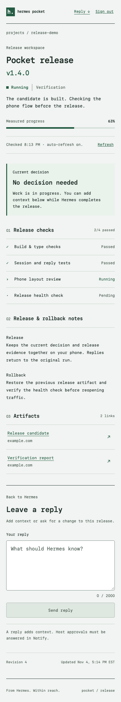
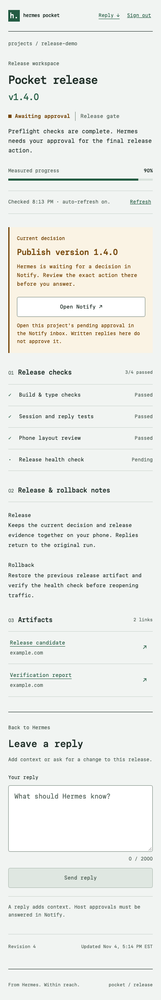
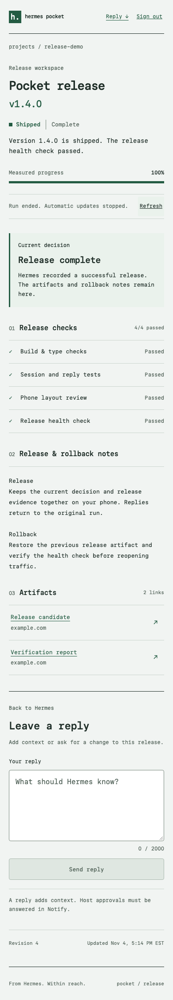

<!-- Exact description of NousResearch/hermes-agent#149220. Keep in sync with gh pr edit. -->

## What does this PR do?

Adds one file, `plugin-catalog/hermes-notify.yaml`, listing **Hermes Pocket** (`hermes-notify`), a community plugin that keeps a release task on your phone through [Notify](https://notify.belweave.ai).

While Hermes works on a release, the plugin publishes a live release workspace as a Notify App, reports measured progress, and routes Hermes's own approval prompts to the phone as native Notify approvals. Written replies from the phone come back to the run and session they belong to. An optional Desktop pane shows Apps, runs, pending decisions and delivery health.

- Repo: https://github.com/Belweave/hermes-notify (MIT)
- Pinned commit: `698b66b6d64a87d317ba97938f37f9ed75f04cd6`
- Version: `"0.2.0"`, tier `community`, platforms `[macos]`

A phone approval only answers the host's approval gate. It can't mark a release shipped. Hermes still has to run and verify the real action before the plugin records a result. The Notify CLI is optional, and the Python runtime has no third-party dependencies and makes no LLM calls.

## Related Issue

None. I searched open and closed PRs and issues for this plugin and didn't find a duplicate.

## Type of Change

- [x] ✨ New feature (non-breaking change that adds functionality)

## Changes Made

- `plugin-catalog/hermes-notify.yaml`: new entry with a full 40-character SHA pin, quoted version, screenshots pinned to the same commit, and a `capabilities` block that matches what the plugin registers.

Nothing else in this repo changes. The plugin, Worker, App, Desktop pane, skill and tests live in the standalone repo.

## Hermes surfaces used

All public. No monkey patches, core overrides, self-updater or credential-file reads.

| Surface | How it's used |
| --- | --- |
| Native entrypoint | `plugin.yaml` (manifest v2, standalone, off by default) and `__init__.py:register(ctx)` |
| Tools (`ctx.register_tool`) | `notify_release`, `notify_publish_app`, `notify_send`, `notify_ask`, `notify_replies`, `notify_status`. No built-in names are replaced. |
| Hooks (`ctx.register_hook`) | `pre_approval_request`, `post_approval_response`. They capture bounded correlation data and queue work. |
| Approval transport | `ctx.register_approval_transport("notify", ...)` takes the host's immutable request and returns only `once` or `deny`. IDs, digest, scope and deadline must all match. Runs in-process because it holds the live approval channel. |
| Skill | `notify-release-workspace` through `ctx.register_skill` |
| Secrets and config | `agent.secret_scope.get_secret` for `NOTIFY_API_TOKEN` (required) and `HERMES_NOTIFY_PUBLISH_TOKEN` (optional); `ctx.get_config`, `ctx.state.data_dir`, `ctx.on_unload` |
| Session | Handler kwargs and `gateway.session_context.get_session_env`. Optional `ctx.inject_message` only when the operator turns it on, for the same live session, with replies marked as untrusted input. |
| Desktop / dashboard | `@hermes/plugin-sdk` pane, route and sidebar entries, plus a read-only dashboard backend on the public plugin storage path. Opt-in, English. |
| Middleware | None |

## Capabilities

```yaml
capabilities:
  provides_tools: [notify_release, notify_publish_app, notify_send, notify_ask, notify_replies, notify_status]
  provides_hooks: [pre_approval_request, post_approval_response]
  provides_middleware: []
  requires_env: [NOTIFY_API_TOKEN]
```

These match the manifest, and a registration test compares them with what the plugin actually registers. The approval transport, skill and Desktop pane have no capability fields, so they're listed in the table above.

## Disclosures (rule 13)

The repo README has the same list.

- **Network:** when you enable it, the plugin sends selected release content, messages and host-redacted approval requests to the Notify Agent API (`https://notify.belweave.ai/api/agent`) and to the HTTPS Worker you configure. The Worker only fetches Notify's official JWKS to verify sign-in. Artifact links you open yourself can go to other HTTPS hosts.
- **Reads outside its own data:** none. The plugin reads its own package files and its profile-owned database and snapshot, and it gets config, secrets and session identity only through Hermes APIs. It never reads `.env`, `auth.json`, browser profiles, the keychain or other tools' logins.
- **Shell commands:** the runtime runs none. Dev scripts (tests, Worker build, local rehearsal) run only when you call them, and the plugin never loads them.
- **Background work:** one lazy worker with a bounded 64-item queue, at most two concurrent approval waits with bounded long polls and host deadlines, and progress coalesced to at most once every five seconds. No idle poller or inbound listener runs in the Python plugin. Unload cancels queued work.
- **Stored credentials and data:** Hermes stores the credentials. Tokens stay in memory and are never written to the journal, snapshot or UI. The Worker gets its own publish and webhook bindings, never the Notify API token, and stores only hashes of session cookies. Local and Worker SQLite keep workspace notes, replies and delivery records within documented limits.
- **Hosting:** private Apps need a Cloudflare Worker you deploy yourself. The plugin never deploys infrastructure.
- **Telemetry:** none.

## How to Test

1. Clone https://github.com/Belweave/hermes-notify and check out `698b66b6d64a87d317ba97938f37f9ed75f04cd6`.
2. `hermes plugins validate . --install-deps`, then `hermes plugins doctor . --ci`
3. Optional, full suite (see `docs/VERIFICATION.md`): `uv sync --only-group dev`, `.venv/bin/python scripts/fetch_hermes.py`, `.venv/bin/python -m pytest`, `node worker/scripts/isolated.mjs test`, then the App, Desktop and backend commands.
4. Optional, local rehearsal against real Hermes approval and local workerd with mocked Notify: `.venv/bin/python scripts/release_demo.py --answer approve` (also `deny` and `timeout`).

**Validate output at the pinned commit** (clean `git archive` export, empty `HERMES_HOME`; rerun on Linux x86_64 for this pin, earlier pins also on macOS arm64):

- `hermes plugins validate --install-deps`: exit 0, `ok: true`, 16 of 16 checks pass (manifest, manifest fields, requires_hermes, config schema, requires_env, oauth, loadable, python dependencies, capability probe, declared tools, declared hooks, declared middleware, built-in tool collisions, security scan, no core override, desktop surface).
- Security scan: `safe`.
- One warning: private core imports in dev-only scripts (`scripts/release_demo.py`, `scripts/spike.py`, `scripts/validate_package.py`). They drive the real plugin manager and admission checker during local rehearsal, and the plugin entrypoint never loads them.
- Isolation: `in_process`, because the approval transport holds the live request and response channel.
- `hermes plugins doctor --ci`: runtime discovery, manifest parsing, import and registration passed. 6 tools, 2 hooks.

**Upstream checks in this branch:** `scripts/validate_plugin_catalog.py plugin-catalog/` reports 978 valid files, with no errors or warnings for this entry. The catalog test set passes (691 tests) and `scripts/check` is ok.

**Plugin tests at the pinned commit:** 259 passing. Python 127, Worker 23, App browser 72, Desktop SDK 9, dashboard backend 28. The pin also makes the HTTP client send an explicit `hermes-notify/0.2.0` User-Agent, because workers.dev answers Python's default agent with 403; a regression test checks the header on the health check and publish calls. That includes regression tests for five recovery bugs found in review: stale publication retries, final progress after unload, lost activity starts, reply page size, and global delivery records in the Desktop status.

Tested on macOS (arm64) only, so the entry declares only `macos`. A minimum released Hermes version isn't verified yet, so the entry doesn't declare a `requires_hermes` floor. Testing was against Hermes source `ed1afb082eb3e46cf2edae9d8f68fb67b09ee4df`.

## Checklist

### Code

- [x] I've read the [Contributing Guide](https://github.com/NousResearch/hermes-agent/blob/main/CONTRIBUTING.md)
- [x] My commit messages follow [Conventional Commits](https://www.conventionalcommits.org/)
- [x] I searched for [existing PRs](https://github.com/NousResearch/hermes-agent/pulls) to make sure this isn't a duplicate
- [x] My PR contains **only** changes related to this feature (one catalog file)
- [ ] I've run `pytest tests/ -q` and all tests pass. Not the full suite: I ran the catalog CI's test set (`scripts/run_tests.sh` on the 35 files from `scripts/ci/catalog_test_files.py`), and all 691 tests passed in this branch's checkout.
- [x] `python scripts/check` passes (14 checks, ok)
- [x] I've added tests for my changes (in the plugin repo, 259 passing)
- [x] I've tested on my platform: macOS (arm64)

### Documentation & Housekeeping

- [x] I've updated relevant documentation: the plugin README covers install, config, disclosures and the demo flow
- [x] `cli-config.yaml.example`: N/A
- [x] `CONTRIBUTING.md` / `AGENTS.md`: N/A
- [x] Cross-platform impact considered: only macOS is declared
- [x] Tool descriptions/schemas: N/A for core

## Screenshots

Chromium captures of the shipped App code at a phone viewport, using test fixtures. The approval itself is answered in Notify's native approval prompt.







