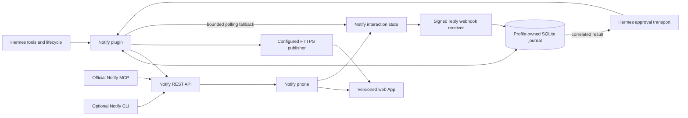

# Hermes Pocket

Recommend **Hermes Pocket: Notify is the phone surface for Hermes.** Hermes publishes a useful, persistent Notify App; rich pushes, approvals and replies, Live Activities, and the project inbox keep the same task in reach. The defining moment is opening the app Hermes just made and changing what happens next from that screen.

The first local implementation now includes the release workspace App, Cloudflare Worker publisher, progress, exact native approvals, written replies, signed webhook receipt and a Desktop/Webapp companion. [VERIFICATION.md](VERIFICATION.md) separates tested local behavior from the remaining phone and deployment checks. [RESEARCH.md](RESEARCH.md) records verified interfaces and source limits; [PLAN.md](PLAN.md) gives the delivery sequence.

## Three concepts

| Concept | Experience | Strength | Limitation |
| --- | --- | --- | --- |
| Notify Companion | Push important events, request approvals, track work on the phone. | Small, dependable, easy to install. | Much of its visible value can be reproduced by MCP tools and a skill; overlaps existing mobile chat and approvals. |
| Hermes Pocket | Every selected project has a phone App with its artifacts, current state, next decision, and reply path. Hermes publishes and updates it. | Combines useful software creation with native reach and a real host integration. Strongest fit for the brief and short demo. | Needs a clear hosting contract and durable coordination across deployment, registration, and delivery. |
| App Studio | General App builder with a template gallery, hosting integrations, sharing, offline packages, and device features. | Broad creative potential; Apps are the whole product. | Too many independent reliability and platform problems for one week. Offline package runtime is not ready for the target physical-device demo. |

Choose Pocket. Keep its first publishing workflow small enough to finish: one hosting adapter, one project workspace template, one phone, and one approval that changes the app. Preserve an existing-URL path for users who already host an app.

## What the plugin owns

A prompt can suggest a good message, and MCP can send it. This plugin owns the work that must happen reliably without model cooperation: intercepting supported Hermes approvals, preserving exact action scope, associating sessions with Apps and inbox projects, handling lifecycle events, deduplicating delivery, and recovering partial publication. The model supplies content and intent. It does not write permission decisions or webhook receipts.

Hermes remains the place to talk to the agent, inspect tools, and manage sessions. Notify is the place to use the resulting app, see a concise native progress surface, answer a specific question, and retain project artifacts. Do not build a second general chat client.

The official native Hermes mobile beta has no verified public contract for rendering third-party plugin UI. Desktop SDK panes, transcript cards, and tool views are supported in Desktop and its browser Webapp; they must not be presented as native mobile integration. [RESEARCH.md](RESEARCH.md#does-official-hermes-mobile-render-plugin-ui) records file-and-line evidence and the remaining private-beta uncertainty. Pocket uses Notify for the complete phone experience regardless of that beta's capabilities. Its optional Hermes pane is a Desktop/Webapp companion, never a prerequisite for phone delivery.

## Architecture

Use a small Python runtime with lazy imports. Keep HTTP clients, one bounded worker queue, and SQLite connections owned by the plugin lifecycle. Register through `ctx.*`; unload cancels plugin work. Ordinary observer hooks enqueue compact state changes and return quickly. Never perform a long phone wait in an observer callback or token-stream handler.

The public approval transport is the exception: Hermes already provides a bounded wait and validates the correlated response. It receives the redacted request, creates an approval interaction, and returns a single-use decision. Some Hermes human-input paths do not use this transport. Arbitrary business approvals and text replies therefore also need explicit Notify tools; they must not be described as universal interception.

### Publish an App

Implemented tool: `notify_publish_app(project, run_id?, name?, url?)`. Without `url`, it publishes versioned release-workspace data to the configured Cloudflare Worker. With `url`, it registers an existing hosted App. The Worker hosts the complete static release App, installed separately by the operator. Arbitrary generated-code uploads remain outside this first template. The host is operator-owned; a tool argument cannot introduce a shell command, deploy credential, or hosting endpoint.

1. Resolve the original session, run and existing App mapping. Hash the workspace; persist an operation ID and exact request bytes. Repeated calls resume that operation.
2. Verify the configured Worker's health and schema marker. For an existing URL, validate public HTTPS syntax and skip data publication without fetching an arbitrary destination.
3. Publish the next Worker revision with an atomic expected-revision check. Reconcile an expired saved response only when an authenticated read matches the exact pending workspace. Never overwrite a newer conflict.
4. Register through `POST /api/agent/apps`, or update the saved App. Save the returned `app_` ID. Use a stable App URL across releases so each update preserves identity and phone consent. URL registration itself is not code hosting.
5. Send `POST /api/agent/notifications` with `appId`, the inbox `project`, and a concise summary. Save notification identity and provider-acceptance result. Do not claim the person saw it.
6. The phone opens the live App. Subsequent progress, answers, and artifact revisions change its data without publishing a new app shell for every event.

Journal phases: `prepared -> deployed -> registered -> synced -> announced`; existing-URL publication uses `url_validated` in place of `deployed`. Here `deployed` records accepted workspace data, not infrastructure deployment. Each phase records its remote identifier before the next starts. Publication can succeed even if registration fails, and registration can succeed even if delivery fails. Retry only when the previous outcome is known or safely reconciled. An ambiguous Notify write remains visible as unknown and is not blindly resent. The Worker retains the latest workspace and bounded operation receipts, not an unlimited rollback history.

Notify Apps are ordinary hosted web apps. Start with responsive HTML, CSS, and small JavaScript modules; use a backend only for shared state and authorization. A generated app must not contain an agent token, a deploy token, a webhook secret, or the host's environment. A caller cannot approve an interaction using the agent API.

### Identity and phone features

Use the official microAuth SDK when a private App needs identity. The server issues a browser-bound, one-use random challenge, verifies the ES256 Notify pass with the documented JWKS, and creates its own secure HttpOnly cookie session. Validate protected type `notify-pass+jwt`, issuer `https://notify.belweave.ai`, exact HTTPS audience/origin, App ID, nonce, timestamps, and replay state. Passes last at most two minutes. The pairwise `hk_` subject is origin-scoped; two Apps on the same origin share it. Validate `app_id` separately. Do not map users by email or treat the subject as a global Notify account ID. [Public App contract](https://notify.belweave.ai/docs/web-apps), [JWKS](https://notify.belweave.ai/.well-known/jwks.json).

Profile fields are optional consented data. A successful sign-in can have no name or email. Feature-detect phone capabilities and handle ordinary browser fallback. Revocation stops future passes; our backend must also expire or revoke its own sessions. There is no promise of perpetual sign-in or automatic profile synchronization.

### REST, MCP, webhooks, and CLI

| Interface | Responsibility |
| --- | --- |
| REST | Deterministic lifecycle writes, interaction state, App registration, delivery status, progress, and recovery. This is the CLI-independent runtime path. |
| Official MCP | Access to Notify's broader tool families. Document configuration through Hermes's MCP support and select families per task. Avoid advertising every tool on every model turn or duplicating the core workflow with two competing sets of tools. |
| Reply webhooks | Durable terminal interaction hints when a reachable HTTPS receiver is configured. Verify raw-byte signatures and timestamps, persist before acknowledging, deduplicate, then reconcile with authoritative REST. They never resume a native host permission. |
| Event URLs | Optional inbound automation through Notify service webhooks. Treat URLs as credentials and keep them out of app source and logs. They are distinct from saved reply-webhook subscription IDs. |
| CLI | Optional onboarding, diagnostics, status, and manual recovery. Use explicit JSON output and argv, never shell interpolation. Do not depend on a user's CLI config file for runtime secrets. The integration works when `notify` is absent from PATH. |

Support the full public surface through the official MCP interface and documented REST/CLI equivalents, while presenting a short set of workflow tools in normal Hermes use. Team administration, connectors, on-call, and Mini Apps remain discoverable advanced capabilities, not automatic side effects of installing Pocket.

A local process behind NAT uses outbound long polling by default. Webhook mode requires an explicitly configured reachable receiver, possibly a small hosted companion. Do not silently install a tunnel or expose Hermes to the internet. A webhook is a wake-up signal carrying a recorded outcome, not permission to execute arbitrary text. A late response may update history, but it cannot resurrect an expired Hermes request.

Keep business decisions and conversation replies separate from host permissions. A waiting `notify_ask` tool can return the recorded decision directly. A later text reply is stored against the original profile, session, task, and interaction, then delivered as attributed task input through `ctx.inject_message` only when Hermes permits that operation. Otherwise expose it on the next session turn or in the project inbox. A reply is never a shell command or a substitute for an expired host approval. Do not create an unrestricted inbound messaging adapter just to deliver these replies.

Use saved generic reply webhooks for lifecycle delivery. Their signature is `X-Notify-Signature: t=...,v1=...`; verify the raw bytes and a five-minute freshness window, then deduplicate `X-Notify-Delivery-Id` and the stored interaction outcome. Per-question callbacks instead use `Notify-Timestamp` / `Notify-Signature` and a different body. Keep separate parsers. Inbound `/hooks/whk_...` service URLs are credentials, not these saved subscription IDs. The exact contracts and retries are in [the webhook research](notes/notify-api.md#webhook-directions-and-receiver-contracts).

## Features ranked by demo impact

| Rank | Feature | Visible proof | Implementation state |
| --- | --- | --- | --- |
| 1 | Publish a full interactive App to the phone | Tap a rich notification and use a project workspace created by Hermes. | Implemented and tested locally |
| 2 | Exact approval changes the workflow | Approve one named operation; Hermes and the App show the resulting state. | Mock suite plus one live phone approval passed |
| 3 | Live progress | The phone's native progress surface changes as work advances, then ends cleanly. | Implemented and tested locally |
| 4 | Project inbox and rich updates | Artifacts and decisions stay together after the chat moves on. | Implemented and tested locally |
| 5 | Written reply into the correct session | A short phone reply becomes input to the original task, with provenance. | Implemented and tested locally |
| 6 | Desktop companion pane | Open Apps, pending decisions, recent delivery state, and configuration. | Implemented and tested locally |
| 7 | Optional sign-in and phone capabilities | The App recognizes its consenting user without asking for a password. | Synthetic SDK session verified; confirm live bridge |
| 8 | Full MCP/CLI coverage and diagnostics | Advanced operations remain available; installation works without CLI. | Runtime CLI independence proven; broader integration designed |

## Visual direction

Make the App useful immediately: a clear project title, one current status, a strong artifact preview, a short checklist, and one next action. Show delivery and synchronization problems beside the affected item. Keep transcripts, transport settings, and IDs in diagnostics.

Use Paper Mono across the App and plugin-owned UI, self-hosting the official WOFF2 files with the SIL Open Font License. Declare the available weights explicitly with a monospace fallback. Use spacious type, restrained color, touch targets of at least 44 CSS pixels, reduced-motion support, and accessible contrast. Give the approval a concrete action label. Do not decorate a generic chat window and call it an app.

The Desktop contribution must use documented SDK slots and theme variables; it cannot replace Hermes markup or style another plugin. Notify's native notification and Live Activity layouts remain owned by Notify; the plugin supplies supported fields and design parameters.

## Configuration and secrets

The implemented settings are in `plugin.yaml`: `enabled` defaults to false, `timeout_seconds` defaults to 120, and optional `device_id` chooses one phone. `publisher_origin`, or `worker_name` plus `worker_subdomain`, selects the Worker. `progress_enabled` and `allow_reply_injection` are explicit opt-ins. `progress_interval_seconds` and `retention_days` bound delivery cadence and completed local history. The operator separately selects `security.approval.transport: notify`. Reload after changes; no observer silently changes security configuration.

Approval transports currently require a profile using `plugins.isolation: in_process`. If a user requires host isolation, decline to enable the transport; do not silently weaken that profile. Explicit outbound tools could remain a separate supported mode after their isolation compatibility is tested.

Project/App mapping and pending operation state live in the profile journal. Settings belong under `plugins.entries.hermes-notify.settings`. No token-valued field belongs there. The separate Worker requires `PUBLISH_TOKEN` and an origin-specific `OWNER_SUBJECT`; saved webhook receipt additionally needs `NOTIFY_WEBHOOK_SECRET`.

Supply the token through env or an operator-managed OS-keychain-to-env path. Inside the plugin, resolve the declared `NOTIFY_API_TOKEN` through Hermes's public `agent.secret_scope.get_secret` during registration; never read a credential store or another tool's login directly. The catalog requires this profile-scoped route. Start with `notifications:send`, `interactions:create`, and `interactions:read`. Add `apps:read/write`, `activities:read/write`, and other documented scopes only when enabling the corresponding feature. Public app identity passes and agent bearer tokens have different purposes and never substitute for one another.

SQLite stores profile, session/task, project, operation, request, interaction, App, and activity mappings; payload hashes; transition times; and event deduplication records. It must not store credentials or full prompt/transcript bodies by default. Use restrictive file permissions, a bounded retention period, and one short transaction per transition. Background work must retain its owning profile and account identity explicitly.

## Failure modes

| Failure | Required behavior |
| --- | --- |
| No token, missing scope, revoked token | Clear setup status; zero permission granted; no repeated creation attempts. |
| Prompt create times out | Outcome unknown. Preserve the operation and idempotency key. Reconcile the same intent before retrying. The spike conservatively denies and does not retry. |
| Pending wait times out | Pending is not approval. Continue bounded observation only while the host request remains valid. |
| Denied, expired, canceled, unrelated reply | Do not execute. A text reply saying “approve” is not an approval-kind response. |
| Changed command, digest, App version, or target | Ask a new question for the new action. Never reuse old permission. |
| Duplicate or reordered webhook | Persist and deduplicate. Match stored interaction and action digest, fetch current state, and consume once. |
| Hermes reload or crash | Recover status and tell the person what happened. A lost live authorization request cannot be resumed merely because its old prompt was approved. |
| Deploy succeeded, registration failed | Keep deployment receipt; retry registration. Do not announce success on the phone. |
| Registration succeeded, push failed | Keep the App; report delivery state and offer retry of the announcement only. |
| No capable Live Activity device | Use an ordinary update. Queued work and provider acceptance are separate from display. |
| Phone offline or notification permissions denied | Keep durable inbox/App state, show the pending decision honestly, and respect expiry. |
| Receiver offline or NAT blocks callbacks | Use outbound polling/reconciliation. No hidden tunnel or exposed host port. |
| Device sign-in unavailable or revoked | Show a browser fallback or sign-in state; never fabricate identity from profile data. |
| Flood of tool events | Coalesce per task, bound the queue, and drop intermediate progress. Preserve terminal state and decisions. |

Production targets: no idle polling for inactive tasks; no LLM calls in delivery plumbing; at most two concurrent approval waits initially; progress at most once per five seconds unless state changes; updates use measured work stages rather than invented percentages. Measure memory and request counts on a fresh process before raising limits.

## 85-second demo storyboard

The current rehearsal and timing are in [DEMO.md](DEMO.md). Prepare one authorized test account, a deployed publisher, a warmed release fixture, and a phone with the required capabilities. Record the real round trip. Time-compress build waiting only if clearly labeled; never substitute a staged answer for a live one.

| Time | Screen and action | Evidence |
| --- | --- | --- |
| 0 to 8 s | Hermes begins a release task. | One understandable task. |
| 8 to 20 s | A rich push opens the App's version, checks, notes and artifacts. | A useful persistent workspace. |
| 20 to 32 s | Live Activity moves through a measured release stage. | Native progress. |
| 32 to 44 s | Send a written reply; Hermes retrieves it for the original task. | Working phone input and task correlation. |
| 44 to 60 s | Read the exact release action on the phone and approve once. | Human decision attached to one host request. |
| 60 to 74 s | Hermes executes and verifies the action; the App changes to shipped and progress ends. | Completion follows successful execution. |
| 74 to 85 s | Reopen the saved App and show the outcome. | Durable result and a clean finish. |

If a second capability is unreliable on rehearsal day, simplify the story around the full App and one real approval. A complete, honest 80-second workflow is stronger than a crowded montage of unfinished features.
